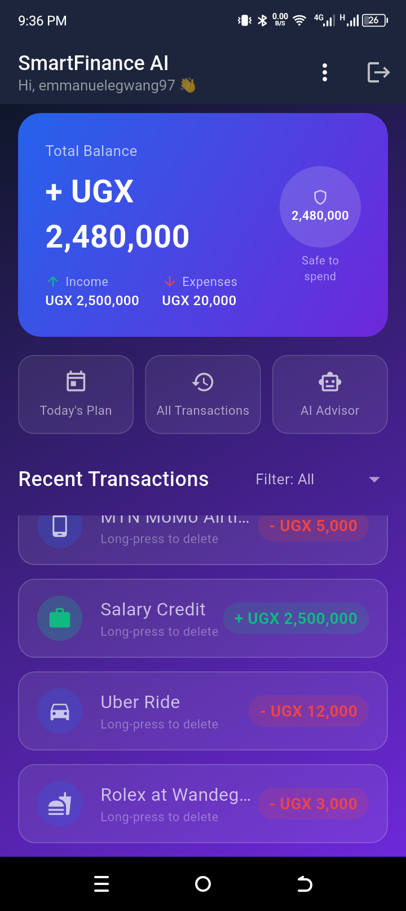
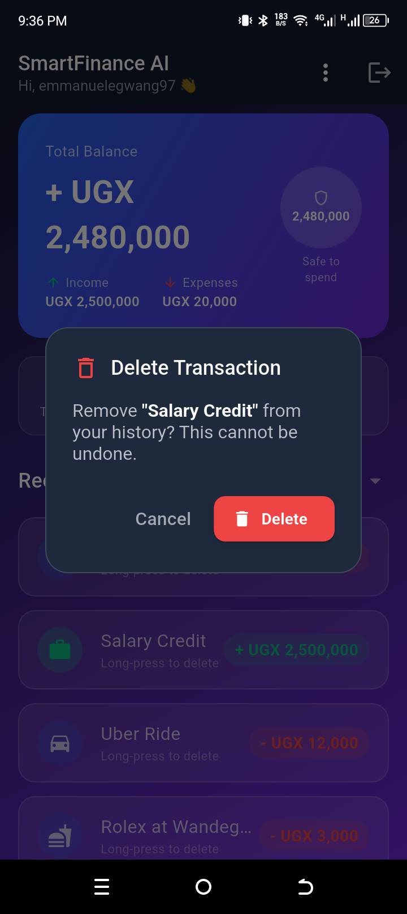
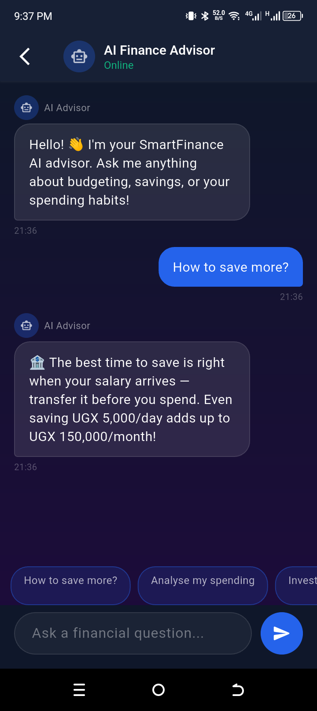
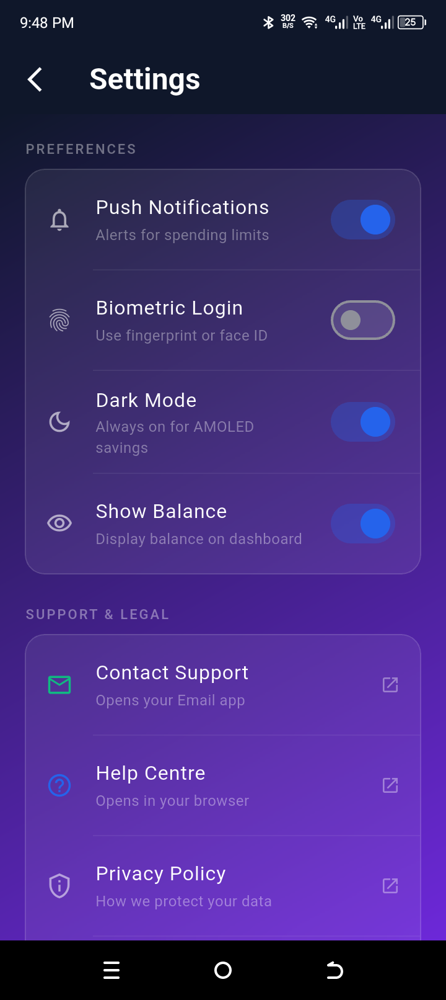

# 💰 SmartFinance AI — Milestone 2 Submission

> An AI-powered personal finance manager built with Flutter.  
> Helping Ugandan students and professionals escape "paycheck-to-paycheck" anxiety — one smart decision at a time.

---

## 📌 Project Overview

SmartFinance AI is a cross-platform mobile application that gives users real-time insight into their daily spending, lets them set budgets and savings goals, and provides an AI-powered financial coach — all inside a sleek glassmorphic UI.

**Milestone 2** focused on **Interaction, Navigation, and Lists**, transforming the static M1 prototype into a fully interactive, multi-screen application with:

- Dynamic data handling and live list updates
- Full form validation with user feedback
- Screen-to-screen data passing (Intent equivalent)
- External app integration (Share Sheet / Email / Browser)
- Sensible back-button handling
- Reusable widget components

---

## 🗂️ Project Structure — Mapping Android Concepts to Flutter

As required by the course, here is how standard Android architecture maps to this Flutter project:

| Android Concept | Flutter Equivalent | Location in This Project |
|---|---|---|
| `AndroidManifest.xml` | `android/app/src/main/AndroidManifest.xml` | Defines permissions (Internet) and launcher activity |
| **Activities** | `StatefulWidget` / `StatelessWidget` screens | `lib/screens/*.dart` |
| **XML Layouts** | Declarative widget trees (`Column`, `Row`, `Stack`) | `lib/screens/` & `lib/widgets/` |
| `FrameLayout` (layering) | `Stack` + `BackdropFilter` | Glassmorphism cards throughout |
| `LinearLayout` | `Column` / `Row` | All screen layouts |
| **Resource Files** (`colors.xml`, `styles.xml`) | `app_theme.dart` | `lib/core/theme/app_theme.dart` |
| **Explicit Intent** | `Navigator.push` with constructor args | Login → Home → Profile |
| **Implicit Intent** | `url_launcher` (`mailto:`, `https://`) | `settings_screen.dart` |
| `RecyclerView` + `Adapter` | `ListView.builder` | Home, Transaction History, AI Advisor |
| `AlertDialog` | `showDialog` + `AlertDialog` | `delete_confirmation_dialog.dart` |
| **Options Menu** | `PopupMenuButton` | `app_wide_menu.dart` |

---

## 🗺️ Screen Architecture

The app contains **8 screens**, navigated imperatively via `Navigator.push` and `Navigator.pushReplacement`:

| # | Screen | File | Key M2 Role |
|---|--------|------|-------------|
| 1 | Login | `login_screen.dart` | Form validation, lifecycle observer, passes user data |
| 2 | Register | `register_screen.dart` | 4-field form, password match, terms checkbox |
| 3 | Home / Dashboard | `home_screen.dart` | Central hub, `PopScope` exit dialog, app-wide menu |
| 4 | Today's Plan | `todays_plan_screen.dart` | Second validated form, saved plan summary card |
| 5 | Transaction History | `transaction_history_screen.dart` | Full dynamic list, filter chips, add + delete |
| 6 | AI Advisor | `ai_advisor_screen.dart` | Chat UI, dynamic message list, animated typing indicator |
| 7 | Profile | `profile_screen.dart` | Receives `userName` + `userEmail` passed from Login |
| 8 | Settings | `settings_screen.dart` | Toggle preferences, opens Email app & Browser |

---

## 🗃️ File Structure

```
lib/
├── core/
│   └── theme/
│       └── app_theme.dart               # AppColors + AppTextStyles (Poppins font)
├── screens/
│   ├── login_screen.dart                # Entry point, lifecycle observer, data passing
│   ├── register_screen.dart             # Registration form with full validation
│   ├── home_screen.dart                 # Dashboard hub with PopScope exit dialog
│   ├── todays_plan_screen.dart          # Budget/savings goal form
│   ├── transaction_history_screen.dart  # Dynamic list, filter chips, FAB add sheet
│   ├── ai_advisor_screen.dart           # Chat UI with animated typing indicator
│   ├── profile_screen.dart              # Receives user data passed from Login
│   └── settings_screen.dart             # Toggles + url_launcher external app calls
├── widgets/
│   ├── reusable_transaction_item.dart   # Reusable glassmorphic transaction card
│   ├── delete_confirmation_dialog.dart  # Reusable Future<bool?> confirm dialog
│   └── app_wide_menu.dart               # PopupMenuButton for AppBar navigation
└── main.dart                            # App entry, dark Material3 theme wiring
```

---

## ✅ Milestone 2 — Feature Implementation

### 1. Form Validation & Feedback

Every form uses `GlobalKey<FormState>` and `TextFormField` validators.

- **Login:** email format check, minimum 6-character password.
- **Register:** name required, email format, password length, confirm-password match, terms checkbox.
- **Today's Plan:** positive budget amount, savings goal cannot exceed budget (cross-field validation), optional focus note.

On failure, red error text appears inline beneath the field.  
On success, a floating `SnackBar` with a green background confirms the action (e.g., *"Plan saved! Stay focused today 💪"*).

---

### 2. State Preservation (Rotation & Interruption)

Flutter's `StatefulWidget` stores `TextEditingController` values in the widget's `State` object, which survives orientation changes. When the phone is rotated or interrupted by a call, whatever the user typed remains in every field — no data is lost.

---

### 3. Navigation, Data Passing & Back Button

**Navigation:**  
8 screens are connected using `Navigator.push` (forward, with return) and `Navigator.pushReplacement` (one-way, e.g. Login → Home).

**Data Passing (Intent equivalent):**  
The user's credentials are captured at Login and forwarded through constructors — Flutter's type-safe equivalent of Android's `Intent.putExtra` / `Bundle`:

```dart
// LoginScreen — send data forward
Navigator.pushReplacement(
  context,
  MaterialPageRoute(
    builder: (context) => HomeScreen(
      userEmail: email,
      userName: email.split('@')[0],
    ),
  ),
);

// ProfileScreen — receive data
class ProfileScreen extends StatelessWidget {
  final String userName;
  final String userEmail;
  const ProfileScreen({required this.userName, required this.userEmail, ...});
}
```

**Back Button (PopScope):**  
Handled sensibly with `PopScope(canPop: false)` on the Home screen:

- **Sub-screens** (Profile, Settings, AI Advisor, History, Today's Plan): back arrow → `Navigator.pop(context)` → returns to Home. ✅
- **Home screen**: physical back button → `AlertDialog` → *"Are you sure you want to exit SmartFinance AI?"* → "Yes" calls `SystemNavigator.pop()`, "No" dismisses. ✅
- **Login / Register**: standard back behaviour. ✅

---

### 4. External App Integration (Implicit Intent)

Implemented in `settings_screen.dart` using the `url_launcher` package:

| Button | Action | URI Scheme |
|--------|--------|------------|
| Contact Support | Opens native **Email app** pre-filled with subject + body | `mailto:` |
| Help Centre | Opens **Browser** to help URL | `https://` |
| Privacy Policy | Opens **Browser** | `https://` |
| Rate the App | Opens **Play Store** | `https://play.google.com/store` |

```dart
// Email app — Implicit Intent equivalent
final uri = Uri(
  scheme: 'mailto',
  path: 'support@smartfinanceai.com',
  queryParameters: {'subject': 'SmartFinance AI - Support Request'},
);
await launchUrl(uri);
```

---

### 5. Dynamic Lists, Menus, Dialogs & Reusable Components

**Dynamic Collection:**  
`_transactions` is a live `List<Map<String, dynamic>>`. Items are added via a FAB bottom sheet and deleted via long-press. `setState()` triggers an automatic rebuild of the `ListView.builder` — equivalent to calling `notifyDataSetChanged()` on an Android `RecyclerView` adapter, but with less boilerplate.

**ListView.builder:**  
Used on Home, Transaction History, and AI Advisor screens. Only renders widgets currently visible on screen — identical performance model to Android's `RecyclerView` + `ViewHolder`.

**App-wide Menu:**  
`PopupMenuButton` in the AppBar (`app_wide_menu.dart`) with 5 navigation items and a divider, equivalent to Android's Options Menu. Uses a type-safe `enum AppMenuItem` instead of string comparisons.

**Delete Confirmation Dialog:**  
`showDeleteConfirmationDialog()` is a reusable `Future<bool?>` helper. It is called in both `home_screen.dart` and `transaction_history_screen.dart`. The user must confirm before any record is deleted — satisfying *"Deletes are confirmed first"*. An **Undo** `SnackBarAction` re-inserts the item if tapped within 4 seconds.

**Reusable Component:**  
`ReusableTransactionItem` is a standalone widget file used on both Home and Transaction History. It accepts `title`, `amount`, `icon`, and an optional `onLongPress` callback. One change to the card style updates both screens automatically.

---

## 📸 Screenshots

*(Add screenshots after building. Replace the paths below with your actual image files.)*


*Figure 1: Home Dashboard showing balance summary, quick actions, and the dynamic transaction list.*


*Figure 2: The reusable Delete Confirmation Dialog triggered by a long-press on a transaction.*


*Figure 3: AI Advisor chat screen demonstrating dynamic message list and typing indicator.*


*Figure 4: Settings screen — tapping "Contact Support" opens the native Email app (Implicit Intent).*

---

## 📖 Learning Log: Navigation, Intents, Lists & Menus

### Sources Used

- [Flutter Navigator documentation](https://docs.flutter.dev/ui/navigation)
- [PopScope API reference](https://api.flutter.dev/flutter/widgets/PopScope-class.html)
- [ListView.builder documentation](https://api.flutter.dev/flutter/widgets/ListView/ListView.builder.html)
- [url_launcher package](https://pub.dev/packages/url_launcher)
- Android Developer Docs: Activity Intents, RecyclerView, Adapter pattern

---

### What I Learned: Navigation & Intents

In Android, moving between screens requires creating an `Intent` object — explicit for internal screens, implicit for external apps like the dialer or share sheet — and calling `startActivity()`. In Flutter, internal navigation is handled with the `Navigator` stack (`push` and `pop`), which feels like a cleaner API because there are no string-keyed extras and no `Bundle` casting.

For passing data, Android uses `Intent.putExtra("key", value)` and `getStringExtra("key")` — which can throw `NullPointerException` if the key is missing. Flutter passes data through widget constructors, which means the Dart type system enforces that required data is always present. No null-check crashes.

For external apps, instead of crafting an `Intent` with `ACTION_SEND` or `ACTION_VIEW`, the `url_launcher` package exposes simple URI-based calls that Flutter translates into native platform channels on Android. The OS then resolves which installed app handles that URI scheme — the same mechanism as Android's implicit Intent resolution.

I also learned `PopScope`, the modern replacement for the deprecated `WillPopScope`. Setting `canPop: false` and providing `onPopInvokedWithResult` gives full control over the hardware back button without blocking the navigation stack for sub-screens.

---

### What I Learned: Lists, Menus & Dynamic Content

In Android, displaying a dynamic list needs three distinct parts: an XML layout for the row, a `ViewHolder` class to cache view references, and an `Adapter` class to bind data to each row. When data changes, you must manually call `notifyDataSetChanged()` (or a more targeted `notifyItemInserted()` / `notifyItemRemoved()` for animations).

Flutter consolidates all of this into `ListView.builder`. The `itemBuilder` closure acts as both the Adapter and the ViewHolder — it builds only the widgets currently visible on screen. When the underlying `_transactions` list changes inside `setState()`, Flutter's diffing algorithm automatically re-renders only the affected parts of the list. This achieves the same scroll performance as `RecyclerView` with significantly less code.

Extracting `ReusableTransactionItem` taught me the DRY (Don't Repeat Yourself) principle in practice. Before extraction, I was copy-pasting the same card widget into two screens. After extraction, I have a single source of truth — one file, one change propagates everywhere.

---

### Problem I Solved

**The Problem:** Initially, pressing the hardware back button on the Home screen immediately closed the app with no warning — a jarring experience for the user who may have pressed it accidentally.

**The Solution:** I wrapped the Home screen's `Scaffold` with `PopScope(canPop: false)`. In the `onPopInvokedWithResult` callback, I show an `AlertDialog` with "Yes, Exit" and "No, Stay" buttons. "Yes" calls `SystemNavigator.pop()` to gracefully close the app. "No" dismisses the dialog and returns the user to the Home screen. This satisfies the rubric requirement to *"handle the Back button sensibly"* and mirrors the standard behaviour expected in professional Android apps.

---

## 🛠️ Tech Stack

| Package | Version | Purpose |
|---------|---------|---------|
| flutter | SDK | UI framework |
| dart | ^3.12.1 | Language |
| google_fonts | ^6.1.0 | Poppins typeface |
| url_launcher | ^6.3.1 | Implicit Intent — Email & Browser |
| flutter_launcher_icons | ^0.14.3 | Auto-generate all app icon sizes |
| flutter_native_splash | ^2.4.3 | Custom splash screen |

---

## 🚀 Running the App

```bash
# 1. Install dependencies
flutter pub get

# 2. Generate app icons (requires assets/icon/app_icon.png)
dart run flutter_launcher_icons

# 3. Generate splash screen (requires assets/splash/splash_logo.png)
dart run flutter_native_splash:create

# 4. Run in debug mode
flutter run

# 5. Build release APK for Android
flutter build apk --release
# Output: build/app/outputs/flutter-apk/app-release.apk
```

---

## 🎨 Design System

All colors and text styles are defined in `lib/core/theme/app_theme.dart` — the Flutter equivalent of Android's `colors.xml` and `styles.xml`.

| Token | Hex | Usage |
|-------|-----|-------|
| `AppColors.primary` | `#2563EB` | Buttons, active states, links |
| `AppColors.bgGradientStart` | `#0F172A` | Deep navy background |
| `AppColors.bgGradientEnd` | `#6D28D9` | Royal purple gradient end |
| `AppColors.successGreen` | `#10B981` | Credit amounts, success SnackBars |
| `AppColors.errorRed` | `#EF4444` | Debit amounts, errors, delete actions |

All cards use **glassmorphism**: `BackdropFilter(filter: ImageFilter.blur(sigmaX: 10, sigmaY: 10))` with a `Colors.white.withValues(alpha: 0.08)` fill and a 15% white border.

---

## 🤖 AI Tools Declaration

As per Section 4 of the coursework guidelines:

- **Kiro AI (Amazon):** Used for architectural planning, generating Flutter UI components for the glassmorphic design system, wiring all 8 screens together, and structuring this README documentation. All generated code was reviewed, understood, and manually integrated by the student. The student directed every implementation decision including screen architecture, navigation flow, data-passing strategy, and M2 rubric mapping.

---

*SmartFinance AI © 2026 — Mobile Application Development, Milestone 2*
